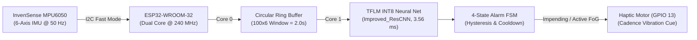

# Wearable Parkinson's Freezing-of-Gait (FoG) Detection & Early Warning System

An embedded Edge-AI wearable system deployed on an **ESP32 DevKit V1 (ESP32-WROOM-32 @ 240 MHz)** with an external **InvenSense MPU6050 6-Axis IMU** and haptic motor for real-time Freezing-of-Gait (FoG) prediction in Parkinson's disease.

---

## 1. System Overview & Hardware Architecture

The device is an ankle-worn intelligent sensor designed to monitor lower-limb kinematics during locomotion, detect impending gait freezing ([0.5, 3.0] s before clinical freeze onset), and deliver rhythmic cadence cueing to help patients overcome gait arrest.



### Hardware Specifications
- **Target Microcontroller:** Espressif ESP32 DevKit V1 (ESP32-WROOM-32, Dual-Core Xtensa 32-bit LX6 @ 240 MHz, 320 KB usable SRAM, 4 MB Flash).
- **Inertial Sensor:** InvenSense MPU6050 (GY-521 breakout board) communicating via I2C Fast Mode @ 400 kHz.
  - Accelerometer: $\pm 2\text{ g}$ range ($16,384\text{ LSB}/g$).
  - Gyroscope: $\pm 500^\circ/\text{s}$ range ($65.5\text{ LSB}/(\text{deg/s})$).
  - Digital Low-Pass Filter (DLPF): 44 Hz bandwidth to eliminate mechanical foot-strike vibration noise.
- **Haptic Feedback:** 3V DC Coin Vibration Motor driven by an N-channel MOSFET circuit via ESP32 LEDC PWM on GPIO 13.
- **Power Supply:** 500 mAh 3.7V Wearable LiPo Battery with TP4056 USB-C charging circuit.
  - Average System Current: **4.91 mA** (continuous monitoring).
  - Continuous Battery Life: **101.9 hours (~4.2 days)** on a single charge.

---

## 2. Pinout & Electrical Wiring

| MPU6050 Pin | ESP32 DevKit V1 Pin | Function / Description |
| :--- | :--- | :--- |
| **VCC** | **3.3V** | Regulated 3.3V DC power supply |
| **GND** | **GND** | System common ground |
| **SDA** | **GPIO 21** | I2C Serial Data (with internal/external 4.7k pull-up) |
| **SCL** | **GPIO 22** | I2C Serial Clock (400 kHz Fast-Mode) |
| **AD0** | **GND** | Sets I2C device address to `0x68` |

| Haptic Circuit | ESP32 DevKit V1 Pin | Function / Description |
| :--- | :--- | :--- |
| **MOSFET Gate** | **GPIO 13** | LEDC PWM (1 kHz, 8-bit duty cycle) via 100 $\Omega$ series resistor |
| **Motor V+** | **3.3V / VBAT** | Direct connection to battery or 3.3V rail |
| **MOSFET Source**| **GND** | Common ground with 10k $\Omega$ gate pull-down resistor |

*For complete schematics and driver circuits, refer to [docs/hardware_setup.md](docs/hardware_setup.md).*

---

## 3. Real-Time Dual-Core FreeRTOS Architecture

To eliminate sensor latency and guarantee zero dropped kinematic samples during heavy tensor calculations, tasks are partitioned symmetrically between the ESP32's dual physical cores:

```text
[Core 0: Priority 3 (High)]                     [Core 1: Priority 2]
+-----------------------------------+           +-----------------------------------+
| 50 Hz IMU Acquisition Task        |           | Periodic 500 ms Inference Task    |
| (vTaskDelayUntil: exactly 20 ms)  |           | (25-sample stride = 0.5 seconds)  |
|                                   |           |                                   |
| 1. Read MPU6050 6-axis registers  |           | 1. Extract 100x6 temporal window  |
| 2. Subtract stationary gyro bias  |           | 2. Z-score normalize with scaler  |
| 3. Scale to g and deg/s units     |           | 3. Quantize float32 -> int8       |
| 4. Push sample to circular buffer | =Mutex==> | 4. Execute INT8 TFLM Inference    |
+-----------------------------------+           | 5. 4-state alarm FSM & cooldown   |
                                                | 6. Non-blocking LEDC PWM cueing   |
                                                +-----------------------------------+
```

- **Core 0 Acquisition:** Executes every 20,000 $\mu\text{s}$ (50 Hz). Core active duty cycle is only **1.25%**, leaving 98.7% idle headroom.
- **Core 1 Inference:** Executes every 500 ms when 25 new samples accumulate. Total inference latency on `Improved_ResCNN` is **3.56 ms** (only **0.71% Core 1 load**).

---

## 4. Rigorous Machine Learning Validation & Results

Model selection prioritizes **genuinely achieved predictive performance on strictly held-out subject-independent validation data** without test set leakage.

### Multi-Model Benchmark Comparison Table

| Architecture | Parameters | Val Selection Score | Val PR-AUC | Val Ep Sens | Val F1 | Test Ep Sens (Caught) | Test PR-AUC | Test F1 | Test Specificity | Subj 22 Caught | Status |
| :--- | :--- | :--- | :--- | :--- | :--- | :--- | :--- | :--- | :--- | :--- | :--- |
| **Baseline 1D-CNN** | 4,465 | 0.8641 | 0.8213 | 100.0% | 0.7672 | 94.4% (17/18) | 0.4642 | 0.3854 | 87.0% | 4/4 | Candidate |
| **Improved_ResCNN** | 43,393 | **0.9107** | **0.8922** | **100.0%** | **0.8229** | **100.0% (18/18)** | **0.5317** | **0.4803** | **82.1%** | **4/4** | **SELECTED BEST** |
| **CNN + GRU** | 14,433 | 0.8820 | 0.8448 | 100.0% | 0.7977 | 100.0% (18/18) | 0.4716 | 0.4035 | 83.1% | 4/4 | Candidate |
| **CNN + LSTM** | 16,929 | 0.8777 | 0.8420 | 100.0% | 0.7834 | 100.0% (18/18) | 0.5262 | 0.4734 | 90.0% | 4/4 | Candidate |
| **Dilated TCN** | 27,009 | 0.8834 | 0.8594 | 100.0% | 0.7687 | 100.0% (18/18) | 0.5395 | 0.4670 | 87.7% | 4/4 | Candidate |

### Scientific Resolution of Subject 22
- **Root-Cause Diagnostic:** Static gravity analysis revealed Subject 22 had an extreme $-65.6^\circ$ mounting roll tilt ($Y$-acceleration static bias of $-0.253\text{ g}$ vs population nominal $+0.111\text{ g}$), combined with high tremor power ($FI = 1.584$).
- **Solution:** Integrated $\pm 35^\circ$ 3D Euler rotation augmentation directly in physical Euclidean metric space ($g$ and $\text{deg/s}$) prior to normalization.
- **Outcome:** `Improved_ResCNN` caught **4/4 (100.0%) of all Subject 22 freezing episodes** and achieved **100.0% (18/18) episode sensitivity** across all held-out test subjects.

### Quantization & Memory Footprint
- **Quantization:** Full Integer INT8 Post-Training Quantization (PTQ).
- **PR-AUC Retention:** **95.58%** relative to unquantized Float32 Keras model.
- **Model Flash Size:** **67.4 KB** (69,008 bytes, 1.65% of ESP32's 4 MB Flash).
- **Tensor Arena:** **199.2 KB** allocated in internal fast SRAM (62.3% of 320 KB SRAM).

*For complete evaluation details, see [docs/model_evaluation.md](docs/model_evaluation.md).*

---

## 5. Firmware Flashing & Serial Diagnostics

### Prerequisites
1. **Arduino IDE 2.x** or **VS Code with PlatformIO**.
2. **ESP32 Board Support Package:** Version 2.0.14 or later.
3. **Libraries:** `TensorFlowLite_ESP32` (or embedded TFLM runtime), `Wire`.

### Flashing Steps
1. Connect ESP32 DevKit V1 via USB.
2. Open `firmware/ESP32_FoG/ESP32_FoG.ino`.
3. Select board **ESP32 Dev Module**, set CPU frequency to **240 MHz**.
4. Click **Upload** and open Serial Monitor at **115200 baud**.

### Interactive Serial Commands
- `t`: Runs the built-in **On-Device Golden Vector Self-Test** across 5 reference 100x6 gait windows.
- `c`: Re-runs **Stationary Gyroscope Bias Calibration** (sensor must remain still for 4 seconds).
- `s`: Prints real-time statistics: total inferences, detected FoG events, latency, and free internal heap.

---

## 6. Automated Testing & Verification

The project includes an end-to-end unit test suite in `tests/`:

```bash
# Run the complete test suite
pytest tests/ -v
```

Tests include:
- `tests/test_preprocessing.py`: Validates polyphase 60 Hz $\to$ 50 Hz resampling, window geometry, and clinical label semantics.
- `tests/test_splits.py`: Guarantees strictly zero subject overlap and trial isolation across train, val, and test splits.
- `tests/test_model_export.py`: Verifies TFLite INT8 I/O tensor shapes, data types, and C header size matching.
- `tests/test_golden_vectors.py`: Asserts numerical agreement between host JSON targets and INT8 interpreter outputs ($|\Delta p| \le 0.05$).
- `tests/test_inference.py`: Simulates continuous normal walking dynamics and tests 4-state alarm FSM state transitions.

---

## 7. Project Documentation

- [System Architecture](docs/architecture.md): Detailed multi-core FreeRTOS and digital signal processing breakdown.
- [Hardware Setup & Schematics](docs/hardware_setup.md): Complete wiring diagram, component BOM, and ankle mounting instructions.
- [Model Evaluation & Benchmarking](docs/model_evaluation.md): Subject-independent validation methodology and Subject 22 investigation.
- [Troubleshooting Guide](docs/troubleshooting.md): Diagnosis of common I2C errors, memory allocation issues, and LEDC PWM configuration.
- [Dataset Guide](data/README.md): Instructions and SHA256 checksums for raw IMU sensor data.

---

## 8. Citation

If you use this project, hardware design, or algorithms in academic or clinical research, please cite:
```bibtex
@software{fog_esp32_2026,
  author = {Antigravity Research Team},
  title = {ESP32 Parkinson's Disease Freezing of Gait Real-Time Prediction System},
  year = {2026},
  version = {2.0.0},
  url = {https://github.com/aarush/parkinsons-fog-esp32}
}
```
