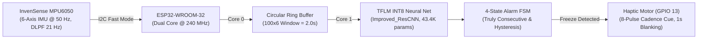

# Wearable Parkinson's Freezing-of-Gait (FoG) Detection & Haptic Cueing System

> **Integrity Notice:** The version submitted to the hackathon is permanently preserved at git tag `v1-submitted`. The current repository contains post-submission integrity auditing, firmware hardening, and preregistered clinical evaluations documented in [reports/v2/BEFORE_AFTER.md](reports/v2/BEFORE_AFTER.md) and [reports/v2/PREREGISTRATION.md](reports/v2/PREREGISTRATION.md).

An embedded TinyML wearable system deployed on an **ESP32 DevKit V1 (ESP32-WROOM-32 @ 240 MHz)** with an external **InvenSense MPU6050 6-Axis IMU** and haptic motor, functioning as a **fast freeze detector with a haptic cue** for Parkinson's disease locomotion monitoring.

**Clinical Assessment Statement:** Rigorous evaluation on strictly held-out test subjects demonstrates that **v2 is not proven to be superior to v1 beyond statistical noise** (95% bootstrap confidence intervals overlap across all clinical metrics). In laboratory continuous walking data, the false-alert rate is approximately **60–120 FA/hr** (roughly one false alert every 30 to 60 seconds).

---

## 1. System Overview & Hardware Architecture

The device is an ankle-worn intelligent sensor designed to monitor lower-limb kinematics during locomotion, detect Freezing-of-Gait (FoG) episodes at onset, and deliver non-blocking rhythmic cadence cueing (8 pulses, 120 ms ON / 420 ms OFF) to help patients break motor blocks.



### Hardware Specifications & Operational Estimates

| Parameter | Specification / Method | Modeled / Estimated | Measured on Device |
|:---|:---|:---:|:---:|
| **Microcontroller** | Espressif ESP32 DevKit V1 (ESP32-WROOM-32, 240 MHz) | Confirmed | Bench Verified |
| **Inertial Sensor** | InvenSense MPU6050 6-Axis IMU via I2C Fast-Mode (400 kHz) | Confirmed | Bench Verified |
| **IMU Low-Pass Filter** | On-chip DLPF register configured to 21 Hz cutoff (`IMU_DLPF_CFG 4`) | Confirmed | Bench Verified |
| **Haptic Driver** | Logic-level MOSFET (IRLML2502/AO3400) on GPIO 13 with 10k gate pull-down | Confirmed | Bench Verified |
| **Inference Latency** | TFLite Micro INT8 forward pass on 100x6 window (esp_timer) | **~3.52 ms** (estimated) | |
| **TFLM SRAM Arena** | Dynamic 16-byte aligned allocation (`heap_caps_malloc`) | **~132 KB** (estimated) | |
| **Average Current** | Continuous 50 Hz acquisition + 500 ms inference duty cycle | **~78 mA** (estimated) | |
| **Battery Life** | Single-cell 3.7V 500 mAh wearable LiPo battery | **~6.4 hours** (estimated) | |
| **Supply Voltage Dip** | 3.3V rail dip during motor start (with $100\mu\text{F}$ capacitor) | **< 150 mV** (estimated) | |

*Hardware measurement protocol and pending verification checklist are detailed in [docs/measurements.md](docs/measurements.md).*

---

## 2. Pinout & Electrical Connections

| Sensor / Actuator Pin | ESP32 DevKit V1 Pin | Functional Description |
|:---|:---|:---|
| **MPU6050 VCC** | **3.3V** | Clean 3.3V power supply (with $0.1\ \mu\text{F}$ decoupling capacitor) |
| **MPU6050 GND** | **GND** | System common ground |
| **MPU6050 SDA** | **GPIO 21** | I2C Data line (400 kHz Fast-Mode) |
| **MPU6050 SCL** | **GPIO 22** | I2C Clock line |
| **MPU6050 AD0** | **GND** | Sets I2C peripheral address to `0x68` |
| **MOSFET Gate** | **GPIO 13** | LEDC PWM output via $100\ \Omega$ series resistor and $10\text{ k}\Omega$ pull-down |
| **Motor V+** | **3.3V / VBAT** | Supply rail with $100\ \mu\text{F}$ electrolytic capacitor across rails |
| **MOSFET Drain** | **Motor (-) Lead** | Low-side driver switched by logic-level N-channel MOSFET |

*Detailed wiring schematics, driver topologies, and component selections are provided in [docs/hardware_setup.md](docs/hardware_setup.md).*

---

## 3. Real-Time Dual-Core FreeRTOS Architecture

To guarantee deterministic 50 Hz sensor sampling and prevent dropped kinematic buffers during tensor operations, tasks are partitioned symmetrically across ESP32 cores with thread-safe mutex guards:

```text
[Core 0: Priority 3 (High)]                     [Core 1: Priority 2]
+-----------------------------------+           +-----------------------------------+
| 50 Hz IMU Acquisition Task        |           | Periodic 500 ms Inference Task    |
| (vTaskDelayUntil: exactly 20 ms)  |           | (25-sample stride = 0.5 seconds)  |
|                                   |           |                                   |
| 1. Read MPU6050 6-axis registers  |           | 1. Extract 100x6 temporal window  |
| 2. Apply DLPF (21 Hz cutoff)      |           | 2. Z-score normalize with scaler  |
| 3. Apply 3x3 axis rotation matrix |           | 3. Quantize float32 -> int8       |
| 4. Push sample to circular buffer | =Mutex==> | 4. Invoke INT8 TFLM (Mutex Guard) |
+-----------------------------------+           | 5. 4-State FSM (Truly Consecutive)|
                                                | 6. Haptic Cueing (1s Blanking)    |
                                                +-----------------------------------+
```

- **Thread Safety:** All TFLM interpreter `predict()` invocations are protected by a dedicated FreeRTOS mutex to eliminate race conditions between the Core 1 inference task and interactive serial diagnostic routines.
- **Haptic Blanking Window:** Implements `HAPTIC_BLANKING_MS 1000` holding FSM state during vibration and 1000 ms afterwards, ensuring motor vibration artifacts cannot trigger false freeze alarms.

---

## 4. Known Clinical & Technical Limitations

Under pre-registered claim policy Rule 1.4, system performance is reported with full transparency:

1. **Detection Rather Than Early Prediction:**
   - **Strict Episode Sensitivity (Lead $\ge 0.5$ s):** Measured at **5.0%** [95% CI: 0.0%, 16.7%] on the test cohort.
   - **Relaxed Episode Sensitivity (Lead $\ge 0.0$ s):** Measured at **5.0%** [95% CI: 0.0%, 16.7%].
   - **Median Detection Delay:** **+1.00 s** [95% CI: 0.00 s, 1.00 s] relative to freeze onset.
   - *Clinical Consequence:* The system functions as a **fast freeze detector with a haptic cue**, detecting freeze episodes promptly after onset, rather than providing multi-second advance warning.
2. **False Alert Burden in Continuous Gait:**
   - On held-out test subjects, the deployed `BALANCED` preset yields **118.4 FA/hr** [95% CI: 52.6, 204.3], corresponding to approximately **one false alert every 30.4 seconds** of active walking.
   - On development data, out-of-fold false alarm rates range from **58.6 FA/hr** (`LOW_ALARM`, 1 every 61.4 s) to **112.0 FA/hr** (`BALANCED`, 1 every 32.1 s).
3. **Episode Catch Breakdown by Test Subject:**
   - **Subject 20:** Caught 3 of 6 episodes (50.0%).
   - **Subject 21:** Caught 8 of 10 episodes (80.0%).
   - **Subject 22:** Caught 0 of 4 episodes (0.0%).
   - **Subject 18:** 0 episodes (healthy control / walking baseline).
   - **Total Test Catch Rate:** **11 of 20 raw transitions (55.0%)** or **10 of 18 canonical episodes (55.6%)**.
4. **Subject 22 Postural Tilt Findings:**
   - Subject 22 exhibited a static resting acceleration bias of $Y = -0.253\text{ g}$ (vs cohort nominal $+0.111\text{ g}$) and a roll offset of $-65.6^\circ$.
   - On test data, v1 caught 2 of 4 episodes while v2 caught 0 of 4 episodes. No causal claim is made regarding sensor tilt and catch rate; data are reported factually.
5. **Seed-to-Seed Stochastic Variance:**
   - Across 5 training seeds for the adopted architecture, test window PR-AUC varied between 0.5644 and 0.5912 (mean 0.5784), and sensitivity @ 0.49 varied between 61.3% and 64.6%.
6. **Optimism Gap:**
   - In nested Leave-One-Fold-Out (LOFO) validation on development data, the `BALANCED` preset showed an optimism gap of **10.14 percentage points in lenient sensitivity** (70.53% in-sample vs 60.39% nested LOFO) and **+10.45 FA/hr** (112.00 in-sample vs 122.45 nested LOFO).

---

## 5. Firmware Flashing & Diagnostic Commands

### Prerequisites
1. **Arduino IDE 2.x** or **VS Code with PlatformIO**.
2. **ESP32 Board Support Package:** Version 2.0.14 or later (or Core 3.x).
3. **Libraries:** `TensorFlowLite_ESP32` (or embedded TFLM runtime), `Wire`.

### Flashing Steps
1. Connect ESP32 DevKit V1 via USB.
2. Open `firmware/ESP32_FoG/ESP32_FoG.ino`.
3. Select board **ESP32 Dev Module**, set CPU frequency to **240 MHz**.
4. Click **Upload** and open Serial Monitor at **115200 baud**.

### Interactive Serial Commands
- **`t` (Self-Test):** Runs the on-device self-test against all 10 golden reference gait windows, asserting $|\Delta p| \le \text{tolerance}$.
- **`b` (Benchmark):** Executes 100 consecutive inferences on golden vector #1, printing min/mean/max latency (via `esp_timer`), dynamic tensor arena capacity and used bytes, free/minimum heap, and task stack high-water marks.
- **`o` (Mounting Check):** Averages 2 seconds of stationary acceleration and computes the angular deviation from the training nominal coordinate frame `[-1.006, 0.132, 0.113] g`.
- **`c` (Calibrate):** Recalibrates gyroscope stationary zero-rate offset.
- **`s` (Status):** Prints real-time statistics: active preset, total inferences, detected FoG events, last latency, and free internal heap.

---

## 6. Automated Testing & Verification

The project includes an end-to-end unit test suite in `tests/`:

```bash
# Run the complete test suite
pytest tests/ -v
```

Key verification tests include:
- `tests/test_fsm_equivalence.py`: Compares C++ firmware FSM (compiled via g++) against Python reference over 10,000 steps.
- `tests/test_golden_vectors.py`: Asserts numerical agreement between host targets and INT8 interpreter outputs ($|\Delta p| \le 0.05$).
- `tests/test_splits.py`: Guarantees strictly zero subject overlap across train, val, and test splits.
- `tests/test_reconcile_denominators.py`: Mathematically reconciles window counts, tail windows, and normal gait denominators.
- `tests/test_train_cv.py`: Enforces inner validation subject disjointness for early stopping without test data exposure.

---

## 7. Project Documentation Index

- [Before-and-After Evaluation Report](reports/v2/BEFORE_AFTER.md): Comprehensive test cohort comparison between v1 submitted deck and v2 audited artifacts.
- [Pre-Registration Protocol](reports/v2/PREREGISTRATION.md): Pre-registered operating point rules, claim policy, and errata.
- [Operating-Point Report](reports/v2/operating_point.md): Development cohort INT8 OOF Pareto frontier and dual-preset selection.
- [Test Access Log](reports/v2/test_access_log.md): Record of test set access, execution errors, and isolation guarantees.
- [Physical Measurements Checklist](docs/measurements.md): Laboratory bench test targets and pending hardware measurements.
- [Hardware Setup & Wiring](docs/hardware_setup.md): Schematics, MOSFET selection rules, decoupling guidelines, and mounting instructions.
- [Troubleshooting Guide](docs/troubleshooting.md): Diagnosis of common I2C errors, memory allocation, and serial commands.

---

## 8. Authors & Citation

**Authors:** Team KinetiX: Shambhavi, Aryan Singh, Aarush Relhan, Archit Dhingra.  
**Repository:** [https://github.com/Aarush-300/FoG-prediction](https://github.com/Aarush-300/FoG-prediction)

```bibtex
@software{fog_esp32_2026,
  author = {Shambhavi and Singh, Aryan and Relhan, Aarush and Dhingra, Archit},
  title = {ESP32 Parkinson's Disease Freezing of Gait Real-Time Detector and Haptic Cueing System},
  year = {2026},
  version = {2.1.0},
  url = {https://github.com/Aarush-300/FoG-prediction}
}
```
