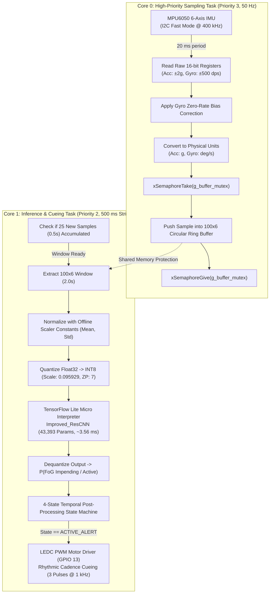
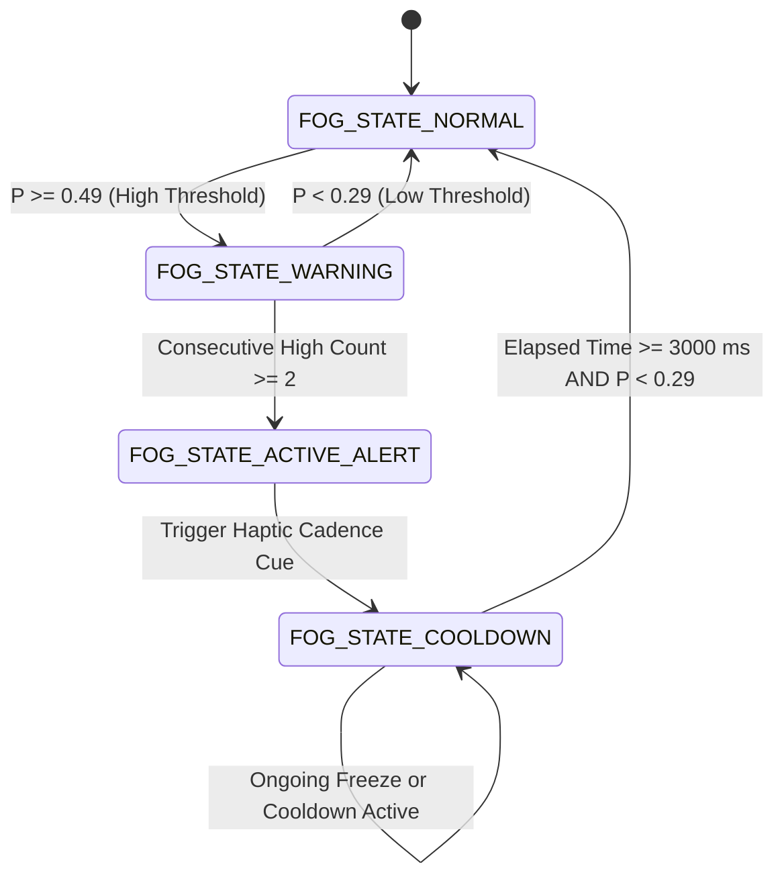

# System Architecture & Technical Specifications

## 1. Dual-Core FreeRTOS Architecture (ESP32-WROOM-32)

The wearable system uses Espressif's dual-core 32-bit Xtensa LX6 microcontroller running FreeRTOS. Workloads are partitioned symmetrically between cores to guarantee zero dropped IMU samples while executing deep convolutional inference.

---

## 2. Signal Preprocessing & Temporal Windowing Pipeline

### Resampling Strategy
The clinical laboratory data recorded at 60 Hz is resampled to 50 Hz using polyphase rational factor filtering (`scipy.signal.resample_poly(up=5, down=6)`):
$$\frac{f_{\text{target}}}{f_{\text{source}}} = \frac{50\text{ Hz}}{60\text{ Hz}} = \frac{5}{6}$$
Resampling is strictly applied within individual trial recordings to prevent artificial discontinuity boundary artifacts.

### 2.0-Second Sliding Windows
- **Window Length:** 100 samples ($2.0\text{ s} \times 50\text{ Hz}$).
- **Stride:** 25 samples ($0.5\text{ s} \times 50\text{ Hz}$).
- **Channels (6):** `acc_x`, `acc_y`, `acc_z` (in $g$), `gyro_x`, `gyro_y`, `gyro_z` (in $\text{deg/s}$).

### Labeling Taxonomy
Windows are classified into four mutually exclusive clinical regimes:
1. **Normal Gait (`0`):** No freeze within the window AND the next freeze onset is $> 3.0\text{ s}$ in the future.
2. **Pre-FoG Early Warning (`1`):** No active freeze in the window, but an impending freeze occurs within $[0.5, 3.0]\text{ s}$ after window termination.
3. **Active Freezing (`2`):** $\ge 50\%$ of the window overlaps an active clinical freeze episode.
4. **Transition (`-1`):** Window overlaps $< 50\%$ active freeze or falls within $< 0.5\text{ s}$ immediately preceding freeze onset.

---

## 3. Four-State Temporal Alarm Finite State Machine

To prevent transient noise spikes from causing false tactile alarms while ensuring rapid cues during impending freezes, predictions pass through a 4-state hysteresis state machine:

- **Exponential Moving Average (EMA):** $P_{\text{smooth}, t} = 0.60 \cdot P_{\text{raw}, t} + 0.40 \cdot P_{\text{smooth}, t-1}$
- **Hysteresis High Threshold:** $0.49$
- **Hysteresis Low Threshold:** $0.29$
- **Confirmation Filter:** 2 consecutive windows ($\ge 1.0\text{ s}$) above high threshold required to fire.
- **Cooldown Window:** $3,000\text{ ms}$ minimum lockout between distinct episodes.
